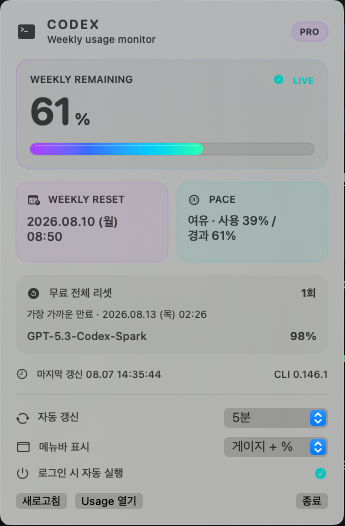
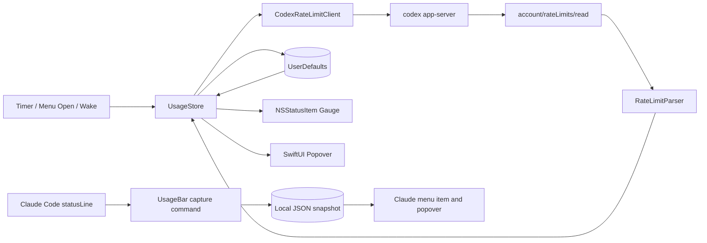

# UsageBar for Codex

[](https://github.com/Harmon96/usagebar-for-codex/actions/workflows/ci.yml)


[](./LICENSE)



UsageBar는 Codex와 Claude Code의 구독 잔여율을 macOS 메뉴바에 표시합니다. Codex의 사용 속도와 토큰 사용 기록을 확인할 수 있고, Claude Code를 연결하면 5시간·주간 잔여율과 리셋 시각을 별도 메뉴에서 볼 수 있습니다. [Claude Code 연결 방법](#claude-code-사용량-추가)

> [!IMPORTANT]
> UsageBar는 OpenAI 또는 Anthropic의 공식 제품이 아닙니다. OpenAI, Codex, Anthropic, Claude는 각 권리자의 상표이며, 이 저장소에는 OpenAI 로고 자산이 포함되지 않습니다.

## 프로젝트 배경

사용량 페이지를 매번 열지 않고 남은 한도와 다음 리셋 시각을 확인하기 위해 만들었습니다. Codex는 로컬 CLI의 로그인 상태를 사용하고, Claude Code는 상태줄에서 데이터를 받아옵니다.

## 주요 기능

### Codex

- 주간 잔여율을 우선 표시하고, 주간 창이 없으면 5시간 등 응답에 있는 기간으로 전환
- 선택된 기간의 잔여율을 `게이지 + %`, `게이지만`, `%만` 중 하나로 표시
- Adaptive 또는 1·2·5·15분 간격 자동 갱신
- 메뉴바를 열거나 Mac이 잠자기에서 복귀했을 때 오래된 값 재검증
- 조회 실패 시 마지막 정상 값을 유지하고 stale 상태, 오류 원인과 단계적 재시도 제공
- 선택된 기간의 리셋 시각, 소비 속도, 리셋 크레딧, 플랜 및 CLI 버전 표시
- 모델별로 가장 많이 소진된 제한의 기간과 잔여율 표시
- 최초 조회 전에는 `확인 중`, 정상 값 없이 조회에 실패하면 `조회 실패` 표시
- 라이트/다크 모드와 디스플레이 구성 변경에 맞춰 메뉴바 게이지 다시 렌더링

### Claude Code

- **Claude 사용량 표시**를 켜면 메뉴바에 별도 항목 추가
- 메뉴바에는 주간 잔여율을 표시하고, 주간 값이 없으면 5시간 잔여율 표시
- 상세 메뉴에서 두 기간의 잔여율·리셋 시각과 마지막 수신 시각 표시

macOS 로그인 시 자동 실행은 설정에서 켤 수 있습니다.

## 고양이 수집

Codex 메뉴에서 **고양이 수집 시작**을 누르면, 그때부터 집계한 로컬 토큰으로 상자에서 새끼를 만나고 성묘로 키웁니다. 고양이가 정착하면 다음 상자가 나타납니다. 도감에는 생활 고양이 12종, [TICA 2026년 6월 Championship 목록](https://tica.org/wp-content/uploads/2026/06/Standing-Rules-Version-C-3-June-2026.pdf)의 품종 82종과 판타지 고양이 8종이 있습니다. 도감에서 대표 고양이를 고정하면 메뉴바와 바탕화면에 표시할 수 있습니다.

- **사용량**에서 원래 Codex 상세와 추적 도구별 합계, 활동 달력, 회고를 볼 수 있습니다.
- **가방과 상점**에서 토큰으로 쌓은 코인으로 간식, 장난감, 반짝 부적, 등급별 상자를 구입하고 사용할 수 있습니다.
- **설정**에서 성장과 가격, 메뉴바 표시, 추적 도구와 추가 폴더를 고릅니다. 바탕화면 고양이는 우클릭 메뉴에서 크기와 애니메이션을 설정할 수 있습니다.
- **저장과 복원**은 설정에서 합니다. 수집 기록은 `~/Library/Application Support/app.usagebar.menubar/cats/` 아래에 저장되며 백업에는 성장, 도감, 코인, 가방과 중복 적립 방지 기록이 함께 들어갑니다.

추적 도구는 Codex, Claude Code, Gemini CLI, Antigravity, OpenCode, Hermes Agent, Cursor, Grok Build CLI, Copilot CLI, Kiro CLI, Pi Agent, omp, omo, Aside, Kimi Code, Devin CLI입니다. Cursor는 로컬에 남은 토큰만 집계하며 Kiro는 로컬 기록의 바이트 길이로 추정합니다. Codex와 Claude Code의 5시간·주간 한도 보상에는 기존 app-server와 상태줄을 사용합니다. 고양이 카탈로그와 픽셀 그림은 앱에 포함되며 도감은 오프라인에서도 열립니다.

바탕화면 고양이에게 외부 도구의 상태를 표시하려면 해당 도구에서 `harmon-usagebar://agent?state=working&label=Codex`와 같은 주소를 엽니다. 상태는 `working`, `waiting`, `done`, `idle`이며, `label`과 `message`는 URL 인코딩해 전달합니다.

수집 흐름과 로컬 사용량 파서 일부는 [PokeTokenBar](https://github.com/chattymin/PokeTokenBar)를 참고했습니다. 이식한 코드의 라이선스는 [외부 코드 고지](./THIRD_PARTY_NOTICES.md)에 있습니다.

## Claude Code 사용량 추가

Claude Code의 Pro·Max·Ultra 구독을 사용하고 있다면 아래 순서로 연결할 수 있습니다. [Claude Code 상태줄 문서](https://code.claude.com/docs/en/statusline)

1. [빌드 및 실행](#빌드-및-실행) 단계에 따라 UsageBar를 엽니다.
2. Codex 메뉴바 항목을 클릭하고 **Claude 사용량 표시**를 켭니다.
3. 새로 나타난 **Claude —** 메뉴에서 **상태줄 명령 복사**를 누릅니다.
4. Claude Code 사용자 설정 파일 `~/.claude/settings.json`에 아래 예시처럼 `statusLine`을 추가합니다. `command` 값에는 복사한 명령을 넣고, 기존 설정이 있다면 같은 JSON 객체 안에 추가합니다.
5. Claude Code에서 응답을 한 번 받습니다. UsageBar는 상태줄이 보낸 값을 15초 이내에 표시합니다. 메뉴를 열면 즉시 확인합니다.

```json
{
  "statusLine": {
    "type": "command",
    "command": "'/path/to/CodexUsageMenuBar.app/Contents/MacOS/CodexUsageMenuBar' --capture-claude-usage"
  }
}
```

### 기존 상태줄을 유지하는 방법

이미 상태줄 스크립트를 쓰고 있다면, 아래처럼 JSON 입력을 UsageBar와 기존 스크립트에 각각 전달하는 래퍼를 사용하세요. 이 예시를 `~/.claude/usagebar-statusline.sh`에 저장한 뒤 앱 경로와 기존 스크립트 경로를 바꾸고, `statusLine.command`를 `/bin/bash ~/.claude/usagebar-statusline.sh`로 지정하면 기존 스크립트의 출력이 계속 표시됩니다.

```bash
#!/bin/bash
input="$(cat)"
printf '%s' "$input" | '/path/to/CodexUsageMenuBar.app/Contents/MacOS/CodexUsageMenuBar' --capture-claude-usage
printf '%s' "$input" | /bin/bash "$HOME/.claude/statusline.sh"
```

### 갱신과 연결 해제

Claude Code가 사용량을 보내면 UsageBar가 마지막 수신 시각을 갱신합니다. 리셋 시각을 지난 값은 숨기고 새 데이터를 기다립니다. 앱을 옮긴 뒤에는 상태줄 명령을 다시 복사해 경로를 갱신하세요.

메뉴바에서 숨기려면 **Claude 사용량 표시**를 끕니다. 데이터 수집까지 중단하려면 Claude Code 설정에서 UsageBar 명령을 빼거나 이전 상태줄 설정을 복원합니다.

## Codex 사용 기록과 그래프

메뉴바 팝오버에 바로 표시되는 그래프에서 `1h`, `6h`, `1d`, `7d`, `30d` 기간을 선택합니다. 시간대별 일반 입력·캐시 입력·출력 토큰 그래프와 모델별 사용 기록, 입력·출력 및 추론 강도별 토큰 합계를 볼 수 있습니다.

메뉴바 팝오버를 열 때 이 Mac의 `~/.codex/sessions`와 `~/.codex/archived_sessions` JSONL 기록을 읽습니다. 원본 대화 내용은 보관하거나 전송하지 않습니다. 응답 ID가 있는 사용 기록은 중복을 제거하며, 이전 형식은 누적 카운터 차이로 복원합니다. 따라서 기록 수는 질문 수와 다릅니다. 캐시 입력은 입력에, 추론 출력은 출력에 포함되며 전체 합계에 다시 더하지 않습니다.

다른 기기·삭제된 기록·압축된 `.zst` 기록은 포함되지 않습니다. 읽지 못한 파일 수는 화면에 안내합니다. 기록이 없는 기간은 실제 사용량 0을 뜻하지 않으며, 토큰 합계는 구독 잔여율이나 실제 청구액과 별개입니다.

## 기술적 특징

| 영역 | 구현 |
| --- | --- |
| 데이터 연동 | Codex는 `codex app-server --stdio`의 `account/rateLimits/read` 응답을 읽고, Claude Code는 상태줄의 `rate_limits`를 받아 사용 |
| 상태 관리 | `@MainActor` 저장소와 Combine으로 메뉴바, popover, 캐시 상태를 일관되게 동기화 |
| 장애 대응 | Codex는 마지막 정상 값을 보존하고 실패 시 재시도. Claude Code의 캐시는 정상 수신 시 갱신하고 기간별로 만료 |
| macOS 통합 | AppKit `NSStatusItem`, SwiftUI popover, `SMAppService` 로그인 항목, wake/display 알림 처리 |
| 로컬 저장 | UI 설정과 Codex 사용량은 `UserDefaults`에, Claude Code 요약 값은 Application Support에 저장 |
| 품질 관리 | SwiftPM, Swift Testing 회귀 테스트, `swift-format`, GitHub Actions 빌드 검증 |

외부 패키지 의존성 없이 Apple 프레임워크만 사용합니다.

## 아키텍처



Codex의 사용량 조회 순서입니다.

1. 일반적인 설치 경로와 현재 `PATH`에서 실행 가능한 `codex`를 찾습니다.
2. `codex app-server --stdio`를 하위 프로세스로 실행합니다.
3. 초기화 요청과 `account/rateLimits/read` 요청을 JSONL로 전송합니다.
4. 응답 ID를 기준으로 필요한 JSON-RPC 결과만 선택하고 10,080분 주간 창을 우선합니다. 주간 창이 없으면 기간이 확인되는 가장 긴 창을 사용하며, 제목·리셋 시각·툴팁에 그 기간을 표시합니다.
5. `usedPercent`를 `100 - usedPercent`로 변환하고 0~100 범위로 제한해 잔여율을 계산합니다.
6. 선택된 기간과 정상 스냅샷을 로컬에 캐시하고 메뉴바와 상세 화면을 갱신합니다. 기간 정보가 없는 이전 버전의 캐시는 복원하지 않고 다시 조회합니다.

Codex app-server 계약은 [OpenAI Codex app-server 문서](https://github.com/openai/codex/blob/main/codex-rs/app-server/README.md)에 공개되어 있습니다. 이 프로토콜이 변경되면 UsageBar의 파서도 업데이트가 필요할 수 있습니다.

## 기술 스택

- Swift 6.2, Swift Concurrency
- SwiftUI, AppKit, Combine
- Foundation `Process` 및 JSON decoding
- ServiceManagement `SMAppService`
- Swift Package Manager, Swift Testing
- GitHub Actions, `swift-format`

## 요구 사항

- macOS 15 이상
- Swift 6.2 이상
- Codex 사용량을 표시하려면 설치 및 로그인된 [Codex CLI](https://github.com/openai/codex)
- Claude 사용량을 표시하려면 구독 한도를 상태줄에 전달하는 [Claude Code](https://code.claude.com/docs/en/statusline)와 Pro·Max·Ultra 계정

앱은 `~/.hermes/node/bin`, `~/.local/bin`, `/opt/homebrew/bin`, `/usr/local/bin`과 현재 프로세스의 `PATH`에서 `codex` 실행 파일을 찾습니다.

## 빌드 및 실행

```sh
git clone https://github.com/Harmon96/usagebar-for-codex.git
cd usagebar-for-codex
zsh ./scripts/build-app.sh
open ./dist/CodexUsageMenuBar.app
```

빌드 스크립트는 릴리스 바이너리를 컴파일하고 새 앱 번들을 만든 뒤, 로컬 실행용 ad-hoc 서명과 무결성 검증을 수행합니다. 생성된 `.build/`와 `dist/`는 Git에서 제외됩니다.

이 저장소는 현재 소스 배포를 전제로 합니다. GitHub Release에 미리 빌드한 `.app`을 배포하려면 본인 소유의 bundle identifier, Apple Developer ID 서명 및 notarization 절차가 별도로 필요합니다. 현재 기본 bundle identifier는 `app.usagebar.menubar`입니다.

## 검증

```sh
xcrun swift-format lint --configuration .swift-format --recursive Sources Tests Package.swift --strict
swift test
zsh ./scripts/build-app.sh
```

GitHub Actions는 macOS runner에서 형식 검사, 단위 테스트와 실제 `.app` 번들 빌드를 모두 실행합니다. 단위 테스트는 JSON-RPC 응답 선택, CLI 버전 파싱, 기간별 창 선택, 모델별 제한, 초기·오류·캐시 상태, 사용 속도 계산을 검증합니다. Claude Code의 상태줄 파싱, 리셋 시 만료, 캐시에서 세션 ID가 제외되는 동작도 확인합니다.

## 프로젝트 구조

```text
.
├── .github/workflows/ci.yml           # macOS CI
├── Resources/Info.plist               # 앱 번들 메타데이터
├── Sources/CodexUsageMenuBar/
│   ├── CodexUsageMenuBarApp.swift     # 앱 진입점, Codex 조회 및 메뉴
│   ├── ClaudeUsageSnapshot.swift    # 상태줄 입력과 로컬 캐시
│   └── ClaudeUsageMenu.swift        # Claude 메뉴바 항목과 상세 화면
├── Tests/CodexUsageMenuBarTests/      # 파싱·계산 회귀 테스트
├── scripts/build-app.sh               # 릴리스 앱 번들 생성·서명·검증
├── Package.swift
├── CONTRIBUTING.md
├── SECURITY.md
└── LICENSE
```

## 개인정보 및 로컬 데이터

- 앱 자체 telemetry, analytics, 광고 SDK 또는 원격 로그 전송은 없습니다.
- UsageBar 자체는 외부 API에 직접 요청하지 않습니다. Codex CLI는 기존 로그인 상태로 사용량을 조회하며, Claude Code는 상태줄 입력으로 사용량을 전달합니다.
- Claude 연동은 두 기간의 사용률·리셋 시각과 마지막 수신 시각만 로컬 Application Support에 저장합니다.
- Codex 인증 파일, 브라우저 쿠키, Keychain 항목 또는 API 키를 직접 조회하거나 자체 저장하지 않습니다.
- 원본 app-server 응답은 디스크에 기록하지 않습니다.
- Codex 하위 프로세스에는 현재 프로세스 환경이 전달되므로 공식 Codex CLI를 신뢰할 수 있는 경로에 설치해 사용해야 합니다.
- 마지막 정상 잔여율과 해당 기간, 리셋 시각, 사용 속도, 플랜, CLI 버전, 리셋 크레딧, 모델별 제한과 UI 설정만 macOS `UserDefaults`에 로컬 캐시합니다.
- `Usage 열기`를 누르면 해당 서비스의 사용량 페이지가 기본 브라우저에서 열립니다.

앱을 종료하고 로그인 시 자동 실행을 먼저 끈 뒤, UI 설정과 Codex 캐시를 초기화하려면 다음 명령을 사용하세요.

```sh
defaults delete app.usagebar.menubar
```

Claude 캐시만 비우려면 Claude Code 설정에서 UsageBar 명령을 먼저 뺀 뒤 `~/Library/Application Support/app.usagebar.menubar/claude-usage.json`을 지웁니다.

## 문제 해결

### Claude 메뉴가 계속 대기 중으로 표시됨

- 구독 플랜을 확인한 뒤 Claude Code에서 응답을 받아 보세요. 각 한도는 독립적으로 들어오며, 한도가 리셋된 직후에는 새 값이 필요할 수 있습니다.
- `statusLine.command`에 복사한 앱 경로가 들어 있는지 확인하세요. 기존 상태줄을 유지 중이라면 래퍼가 Claude Code의 표준 입력을 UsageBar로도 전달하는지 확인하세요.

### Codex CLI를 찾을 수 없음

터미널에서 `codex --version`이 정상 동작하는지 확인하고, 실행 파일이 위의 탐색 경로 중 하나 또는 `PATH`에 있는지 확인하세요.

### 값이 STALE로 표시됨

Codex CLI 로그인 상태와 네트워크 연결을 확인한 뒤 `새로고침`을 누르세요. 앱은 마지막 정상 값을 유지하며 30초, 2분, 5분 간격으로 다시 시도합니다.

### SwiftPM manifest 또는 SDK 오류

`swift --version`, `xcode-select -p`로 활성 toolchain을 확인하세요. Swift 컴파일러와 macOS SDK가 서로 다른 Command Line Tools 설치에서 섞여 있으면 빌드가 실패할 수 있습니다.

## 제한 사항

- Codex CLI의 app-server 응답 형식이 변경되면 앱 업데이트가 필요할 수 있습니다.
- 현재 빌드는 macOS 15 이상만 지원합니다.
- 로컬 빌드의 ad-hoc 서명은 외부 바이너리 배포에 필요한 Developer ID 서명이나 notarization을 대신하지 않습니다.
- 메뉴바 최종 배치는 macOS 버전, 디스플레이 배율과 사용 중인 메뉴바 항목 수에 따라 달라질 수 있습니다.

## 기여

버그 제보와 개선 제안은 환영합니다. 인증 정보나 원본 사용량 응답을 이슈에 첨부하지 말고, 개발 및 검증 절차는 [CONTRIBUTING.md](./CONTRIBUTING.md)를 확인해 주세요. 보안 문제는 공개 이슈 대신 [SECURITY.md](./SECURITY.md)의 비공개 제보 절차를 이용해 주세요.

## 라이선스

이 프로젝트는 [MIT License](./LICENSE)로 배포됩니다.

Built by [Harmon96](https://github.com/Harmon96).
