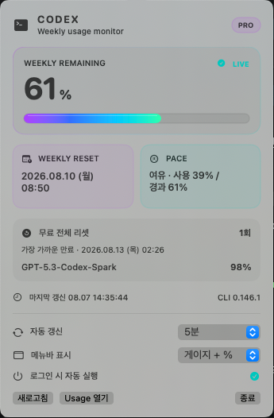
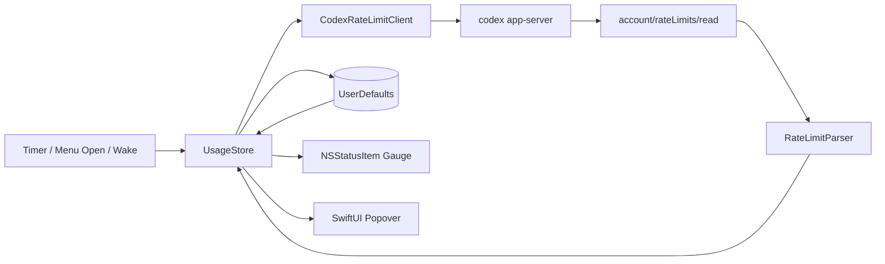

# UsageBar for Codex

[](https://github.com/Harmon96/usagebar-for-codex/actions/workflows/ci.yml)


[](./LICENSE)



UsageBar는 설치된 Codex CLI의 잔여 사용률을 macOS 메뉴바에 표시하는 경량 네이티브 앱입니다. 작업 흐름을 끊고 사용량 페이지를 열지 않아도 게이지, 잔여 퍼센트, 리셋 시각과 사용 속도를 바로 확인할 수 있습니다.

> [!IMPORTANT]
> UsageBar는 OpenAI와 제휴하거나 OpenAI가 승인·후원한 공식 제품이 아닙니다. OpenAI와 Codex는 각 권리자의 상표이며, 이 저장소에는 OpenAI 로고 자산이 포함되지 않습니다.

## 프로젝트 배경

Codex를 장시간 사용할 때는 “얼마나 남았는지”뿐 아니라 현재 소비 속도가 주간 리셋 주기보다 빠른지도 중요합니다. UsageBar는 다음 세 가지 원칙으로 이 문제를 해결합니다.

- **Glanceable UI**: 메뉴바에서 게이지와 숫자를 즉시 읽고, 클릭 한 번으로 상세 정보를 확인합니다.
- **Local first**: 별도 서버나 API 키 없이 로컬 Codex CLI의 기존 로그인 상태를 사용합니다.
- **Resilient state**: 일시적인 조회 실패가 발생해도 마지막 정상 값을 유지하고 오래된 데이터임을 명확히 표시합니다.

## 주요 기능

- 주간 잔여율을 우선 표시하고, 주간 창이 없으면 5시간 등 응답에 있는 기간으로 전환
- 선택된 기간의 잔여율을 `게이지 + %`, `게이지만`, `%만` 중 하나로 표시
- Adaptive 또는 1·2·5·15분 간격 자동 갱신
- 메뉴바를 열거나 Mac이 잠자기에서 복귀했을 때 오래된 값 재검증
- 조회 실패 시 마지막 정상 값을 유지하고 stale 상태, 오류 원인과 단계적 재시도 제공
- 선택된 기간의 리셋 시각, 소비 속도, 리셋 크레딧, 플랜 및 CLI 버전 표시
- 모델별로 가장 많이 소진된 제한의 기간과 잔여율 표시
- 최초 조회 전에는 `확인 중`, 정상 값 없이 조회에 실패하면 `조회 실패` 표시
- 사용자가 명시적으로 켠 경우에만 macOS 로그인 항목 등록
- 라이트/다크 모드와 디스플레이 구성 변경에 맞춰 메뉴바 항목 다시 렌더링

## 기술적 특징

| 영역 | 구현 |
| --- | --- |
| 데이터 연동 | `codex app-server --stdio`를 실행하고 JSONL 기반 `account/rateLimits/read` 응답을 구조적으로 해석 |
| 상태 관리 | `@MainActor` 저장소와 Combine으로 메뉴바, popover, 캐시 상태를 일관되게 동기화 |
| 장애 대응 | 마지막 정상 스냅샷 보존, stale 표시, 제한된 타임아웃, 30초·2분·5분 단계 재시도 |
| macOS 통합 | AppKit `NSStatusItem`, SwiftUI popover, `SMAppService` 로그인 항목, wake/display 알림 처리 |
| 로컬 저장 | 민감한 인증 정보가 아닌 UI 설정과 마지막 정상 사용량만 `UserDefaults`에 저장 |
| 품질 관리 | SwiftPM, Swift Testing 회귀 테스트, `swift-format`, GitHub Actions 빌드 검증 |

외부 패키지 의존성 없이 Apple 프레임워크만 사용합니다.

## 아키텍처



조회 흐름은 다음과 같습니다.

1. 일반적인 설치 경로와 현재 `PATH`에서 실행 가능한 `codex`를 찾습니다.
2. `codex app-server --stdio`를 하위 프로세스로 실행합니다.
3. 초기화 요청과 `account/rateLimits/read` 요청을 JSONL로 전송합니다.
4. 응답 ID를 기준으로 필요한 JSON-RPC 결과만 선택하고 10,080분 주간 창을 우선합니다. 주간 창이 없으면 기간이 확인되는 가장 긴 창을 사용하며, 제목·리셋 시각·툴팁에 그 기간을 표시합니다.
5. `usedPercent`를 `100 - usedPercent`로 변환하고 0~100 범위로 제한해 잔여율을 계산합니다.
6. 선택된 기간과 정상 스냅샷을 로컬에 캐시하고 메뉴바와 상세 화면을 갱신합니다. 기간 정보가 없는 이전 버전의 캐시는 복원하지 않고 다시 조회합니다.

Codex app-server 계약은 [OpenAI Codex app-server 문서](https://github.com/openai/codex/blob/main/codex-rs/app-server/README.md)에 공개되어 있습니다. 이 프로토콜이 변경되면 UsageBar의 파서도 업데이트가 필요할 수 있습니다.

## 기술 스택

- Swift 6.2, Swift Concurrency
- SwiftUI, AppKit, Combine
- Foundation `Process` 및 JSON decoding
- ServiceManagement `SMAppService`
- Swift Package Manager, Swift Testing
- GitHub Actions, `swift-format`

## 요구 사항

- macOS 15 이상
- Swift 6.2 이상
- 설치 및 로그인된 [Codex CLI](https://github.com/openai/codex)

앱은 `~/.hermes/node/bin`, `~/.local/bin`, `/opt/homebrew/bin`, `/usr/local/bin`과 현재 프로세스의 `PATH`에서 `codex` 실행 파일을 찾습니다.

## 빌드 및 실행

```sh
git clone https://github.com/Harmon96/usagebar-for-codex.git
cd usagebar-for-codex
zsh ./scripts/build-app.sh
open ./dist/CodexUsageMenuBar.app
```

빌드 스크립트는 릴리스 바이너리를 컴파일하고 새 앱 번들을 만든 뒤, 로컬 실행용 ad-hoc 서명과 무결성 검증을 수행합니다. 생성된 `.build/`와 `dist/`는 Git에서 제외됩니다.

이 저장소는 현재 소스 배포를 전제로 합니다. GitHub Release에 미리 빌드한 `.app`을 배포하려면 본인 소유의 bundle identifier, Apple Developer ID 서명 및 notarization 절차가 별도로 필요합니다. 현재 기본 bundle identifier는 `app.usagebar.menubar`입니다.

## 검증

```sh
xcrun swift-format lint --configuration .swift-format --recursive Sources Tests Package.swift --strict
swift test
zsh ./scripts/build-app.sh
```

GitHub Actions는 macOS runner에서 형식 검사, 단위 테스트와 실제 `.app` 번들 빌드를 모두 실행합니다. 단위 테스트는 JSON-RPC 응답 선택, CLI 버전 파싱, 기간별 창 선택, 모델별 제한, 초기·오류·캐시 상태와 사용 속도 계산의 핵심 분기를 검증합니다.

## 프로젝트 구조

```text
.
├── .github/workflows/ci.yml           # macOS CI
├── Resources/Info.plist               # 앱 번들 메타데이터
├── Sources/CodexUsageMenuBar/main.swift
├── Tests/CodexUsageMenuBarTests/      # 파싱·계산 회귀 테스트
├── scripts/build-app.sh               # 릴리스 앱 번들 생성·서명·검증
├── Package.swift
├── CONTRIBUTING.md
├── SECURITY.md
└── LICENSE
```

## 개인정보 및 로컬 데이터

- 앱 자체 telemetry, analytics, 광고 SDK 또는 원격 로그 전송은 없습니다.
- UsageBar 자체는 외부 API에 직접 요청하지 않습니다. 설치된 Codex CLI가 기존 로그인 상태를 사용해 필요한 통신을 담당합니다.
- Codex 인증 파일, 브라우저 쿠키, Keychain 항목 또는 API 키를 직접 조회하거나 자체 저장하지 않습니다.
- 원본 app-server 응답은 디스크에 기록하지 않습니다.
- Codex 하위 프로세스에는 현재 프로세스 환경이 전달되므로 공식 Codex CLI를 신뢰할 수 있는 경로에 설치해 사용해야 합니다.
- 마지막 정상 잔여율과 해당 기간, 리셋 시각, 사용 속도, 플랜, CLI 버전, 리셋 크레딧, 모델별 제한과 UI 설정만 macOS `UserDefaults`에 로컬 캐시합니다.
- `Usage 열기`를 누를 때만 기본 브라우저로 Codex 사용량 페이지를 엽니다.

앱을 종료하고 로그인 시 자동 실행을 먼저 끈 뒤, 로컬 설정과 캐시를 초기화하려면 다음 명령을 사용할 수 있습니다.

```sh
defaults delete app.usagebar.menubar
```

## 문제 해결

### Codex CLI를 찾을 수 없음

터미널에서 `codex --version`이 정상 동작하는지 확인하고, 실행 파일이 위의 탐색 경로 중 하나 또는 `PATH`에 있는지 확인하세요.

### 값이 STALE로 표시됨

Codex CLI 로그인 상태와 네트워크 연결을 확인한 뒤 `새로고침`을 누르세요. 앱은 마지막 정상 값을 유지하며 30초, 2분, 5분 간격으로 다시 시도합니다.

### SwiftPM manifest 또는 SDK 오류

`swift --version`, `xcode-select -p`로 활성 toolchain을 확인하세요. Swift 컴파일러와 macOS SDK가 서로 다른 Command Line Tools 설치에서 섞여 있으면 빌드가 실패할 수 있습니다.

## 제한 사항

- Codex CLI의 app-server 응답 형식이 변경되면 앱 업데이트가 필요할 수 있습니다.
- 현재 빌드는 macOS 15 이상만 지원합니다.
- 로컬 빌드의 ad-hoc 서명은 외부 바이너리 배포에 필요한 Developer ID 서명이나 notarization을 대신하지 않습니다.
- 메뉴바 최종 배치는 macOS 버전, 디스플레이 배율과 사용 중인 메뉴바 항목 수에 따라 달라질 수 있습니다.

## 기여

버그 제보와 개선 제안은 환영합니다. 인증 정보나 원본 사용량 응답을 이슈에 첨부하지 말고, 개발 및 검증 절차는 [CONTRIBUTING.md](./CONTRIBUTING.md)를 확인해 주세요. 보안 문제는 공개 이슈 대신 [SECURITY.md](./SECURITY.md)의 비공개 제보 절차를 이용해 주세요.

## 라이선스

이 프로젝트는 [MIT License](./LICENSE)로 배포됩니다.

Built by [Harmon96](https://github.com/Harmon96).
